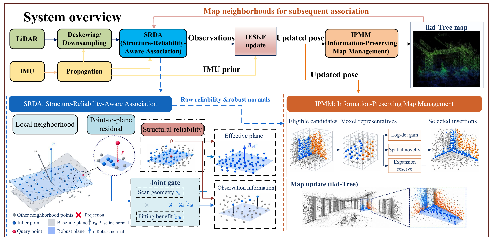

# SRM-LIO

**Structure-Reliability-Aware LiDAR-Inertial Odometry with Information-Preserving Map Insertion**

SRM-LIO is a ROS 2 LiDAR-inertial odometry system for geometrically challenging environments. It combines reliable scan-to-map data association with information-guided map insertion to improve the geometric support available for pose estimation.



## Method

SRM-LIO couples two modules through a shared assessment of local structure:

- **Structure-Reliability-Aware Data Association (SRDA)** evaluates local neighborhoods, uses scan geometry and robust fitting to regulate the associated plane, and adjusts observation information for the iterated error-state Kalman filter (IESKF).
- **Information-Preserving Map Management (IPMM)** selects map insertion candidates using pose information, structural reliability, and spatial novelty, while reserving capacity for map expansion.

IMU propagation and LiDAR deskewing provide the input to scan-to-map association. After each pose update, IPMM inserts selected points into an ikd-Tree map, which supplies neighborhoods for subsequent scans. SRDA and IPMM run together in this release.

## Requirements

- Linux and ROS 2 (the original environment used ROS 2 Humble)
- C++17, `colcon`, and `ament_cmake`
- Eigen3, PCL, Sophus (with CMake package), and yaml-cpp
- ROS dependencies listed in [`package.xml`](src/srm_lio/package.xml)
- Optional: `livox_ros_driver2` for Livox `CustomMsg` input

Source the Livox driver workspace before building when using `CustomMsg`. Without the driver, the package supports `PointCloud2` input.

## Getting started

From the repository root, source ROS 2 and install the ROS dependencies:

```bash
source /opt/ros/humble/setup.bash
rosdep install --from-paths src --ignore-src -r -y
```

Ensure Sophus and its CMake package are available to the build. Replay a ROS 2 bag with the GEODE configuration:

```bash
bash run_srm_lio.sh --build --config geode --bag /path/to/ros2_bag
```

The first run builds the package automatically. Use `--build` to rebuild after changing source files or build dependencies. To run without RViz:

```bash
bash run_srm_lio.sh --config geode_offroad --bag /path/to/ros2_bag --no-rviz
```

For a live Livox sensor, start its driver separately and source the driver workspace before running:

```bash
source /path/to/livox_driver_ws/install/setup.bash
bash run_srm_lio.sh --build --config srm
```

The runner accepts a preset name or a path to a YAML file. Check the input topics, point fields and timestamps, IMU acceleration units, and LiDAR–IMU extrinsics for your recording before running. Bags must already be in ROS 2 format.

## Configuration

Configuration files are in [`src/srm_lio/config`](src/srm_lio/config). Select a preset using the filename without `.yaml`:

| Preset | Intended input |
| --- | --- |
| `srm` | Livox CustomMsg |
| `geode`, `geode_beta` | GEODE Stairs Alpha and Stairs Beta |
| `geode_offroad` | GEODE offroad sequences |
| `subt_mars`, `subt_multifloor` | SubT-MRS sequences |
| `hilti2022_exp7` | Hilti 2022 Exp07 |
| `hilti2022_full_exp14`, `hilti2022_exp16_full`, `hilti2022_exp18_d_full` | Hilti 2022 Exp14, Exp16, and Exp18; see note below |

**Hilti configuration note:** the Exp14, Exp16, and Exp18 files refer to `lio.yaml` as a base configuration, but that file is currently absent from this repository. These presets require the matching base file before they can be used. Verify the effective calibration and parameters before reproducing results.

For the original SubT Mars long corridor playback setting, add `--start-offset 3.05`; the appropriate offset depends on the recording conversion.

## Runner options

```text
--config NAME|PATH    Configuration preset or YAML path (default: srm)
--bag PATH            Replay a ROS 2 bag; omit for live input
--output PATH         New output directory
--no-rviz             Disable RViz
--rate NUMBER         Bag playback rate (default: 1.0)
--start-offset SEC    Skip seconds at the start of the bag (default: 0.0)
--build               Rebuild before launching
-h, --help            Show all options
```

For example:

```bash
bash run_srm_lio.sh --config /path/to/sensor.yaml \
  --bag /path/to/ros2_bag --output /path/to/new_run --no-rviz
```

## Outputs

By default, each run writes to a new `results/<timestamp>_<config>/` directory. A custom `--output` directory must not already exist.

| File | Content |
| --- | --- |
| `trajectory_tum.txt` | Estimated trajectory in TUM format |
| `frame_metrics.csv` | Per-frame metrics |
| `config_used.yaml` | Effective configuration |
| `diagnostics.log` | Runtime diagnostics |
| `map.pcd`, `map_info.txt` | Saved map and map information, when a nonempty map is available |

Use Ctrl+C for a live run so the node can save the final map. Bag playback and the launch shut down when playback or the odometry node exits.

## Tests

```bash
colcon test --packages-select srm_lio --ctest-args --output-on-failure
colcon test-result --verbose
```

The repository includes a numerical test for structure reliability and geometry operations. The release has not yet been verified by a Linux ROS 2 build and bag replay during the repository cleanup.

## License and attribution

Copyright (c) 2026 牟瑀秋. Original SRM-LIO contributions are licensed for **non-commercial academic research and education only**. Commercial use requires prior written permission from the relevant copyright holder(s). See [`LICENSE`](LICENSE) for the terms. Third-party components remain subject to their own licenses; see [`THIRD_PARTY_NOTICES.md`](THIRD_PARTY_NOTICES.md).
